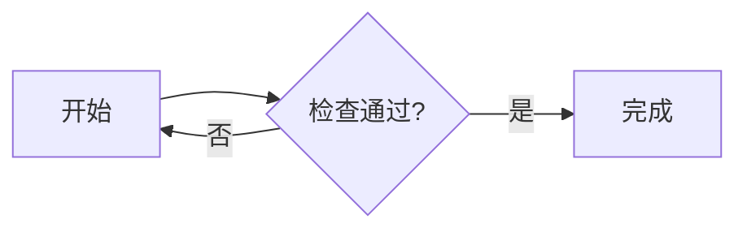

# Mermaid 流程图

对话中的 `mermaid` 代码块支持 `flowchart`、`graph`，包含方向、分支、连线标签和子图。

````markdown

````

代码块闭合后自动生成图形。右上角只显示缩小、比例、放大和全屏图标，悬停可查看说明；放大后直接拖动图形，缩小到 100% 恢复完整视图。全屏在当前工具窗口内展开，按 Esc 或退出全屏图标返回，保留缩放和位置。流式输出未完成、语法错误、渲染超时或 JCEF 不可用时保留可选择的源码。

## 模块

| 包 | 职责 |
| --- | --- |
| `toolwindow/conversation/markdown/diagram` | 从 Markdown AST 识别代码块，管理加载和源码回退 |
| `diagram/renderer` | 渲染协议、应用级服务和共享 JCEF 浏览器生命周期 |
| `diagram/cache` | 按源码、主题复用结果，限制缓存条数和字节数 |
| `diagram/ui/DiagramToolbar` | 单行图标工具栏与 Tooltip |
| `diagram/ui/DiagramViewState`、`DiagramViewport` | 有边界的缩放/平移状态与固定画布绘制 |
| `diagram/ui/DiagramFullscreenHost` | 根布局内全屏、Esc 返回与状态共享 |
| `resources/diagram/mermaid` | Mermaid 11.12.1、本地运行脚本和许可证 |

Mermaid 在本地生成 SVG，再由 Chromium 输出高清 PNG 交给 Compose。当前 Skia 对 Mermaid 的 SVG 文字和箭头支持不完整，因此显示使用 PNG，缓存保留原始 SVG。栅格图片最长边 4096 像素、最多 800 万像素；高倍放大受原图分辨率限制。

无需网络或额外安装 Node。共享浏览器首次使用时创建；取消、超时会回收浏览器；应用/插件销毁时同步释放浏览器和隐藏宿主窗口。缓存最多 48 条、8 MiB。每次渲染最长 15 秒，源码最多 20,000 字符，最多 200 条边。

首期不支持时序图等其他 Mermaid 类型、源码配置指令和 HTML 标签。未支持的内容保留源码，可通过文本选择复制。正常图形不显示源码操作按钮。

图标来自 Google Material Symbols Outlined，本地打包，来源和 Apache 2.0 许可证见 `resources/icons/diagram/`。

## 验证

```bash
./gradlew test --tests 'com.auracode.assistant.diagram.*' \
  --tests 'com.auracode.assistant.toolwindow.conversation.markdown.*'
./gradlew buildPlugin
```

本地浏览器回归测试使用开发用 Playwright，不会将 Node 或浏览器依赖打进插件：

```bash
npm install --prefix /tmp/aura-diagram-check playwright@1.58.2
AURA_PLAYWRIGHT_MODULE=/tmp/aura-diagram-check/node_modules/playwright \
AURA_CHROMIUM_EXECUTABLE='/Applications/Google Chrome.app/Contents/MacOS/Google Chrome' \
node src/test/js/mermaid-runtime.test.cjs
```

其他系统可指定本机 Chromium 路径；已安装 Playwright Chromium 时可省略 `AURA_CHROMIUM_EXECUTABLE`。

真实 IDE 验收：分别在浅色/深色主题展示上述示例，测试分支、中文和子图；打开全屏后连续放大到上限、拖动、缩放窗口，反复进入/退出全屏并按 Esc 返回，确认缩放和位置保留；使用不完整及错误语法检查源码回退；关闭 IDE 检查无新增资源泄漏。

插件复用 IDE 自带的协程运行时，不再打包第二份 `kotlinx-coroutines-core`。全屏位于正文的 `SelectionContainer` 外，图形与工具栏使用 `DisableSelection`，避免跨布局选择坐标异常。缩放只改变 Canvas 绘制变换，不改变布局或纹理尺寸。
